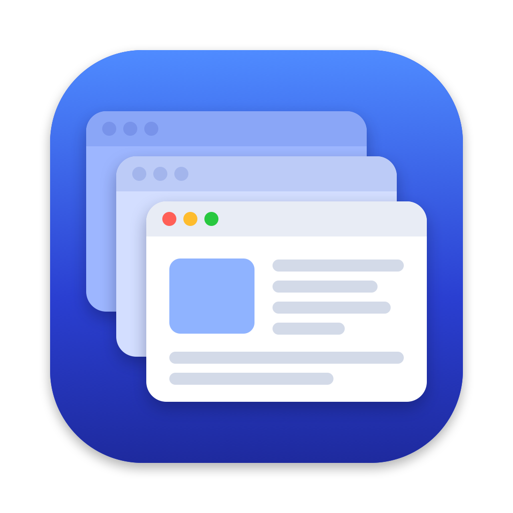
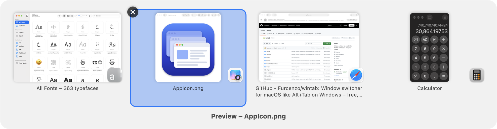
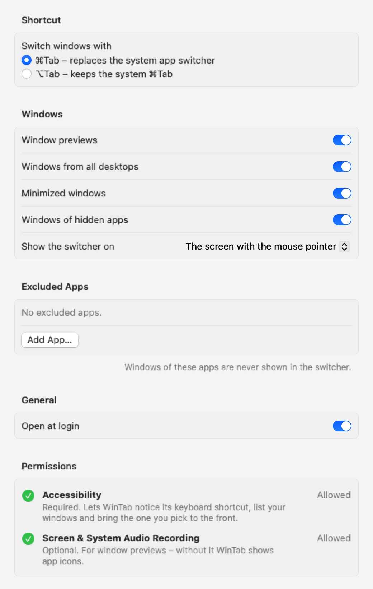
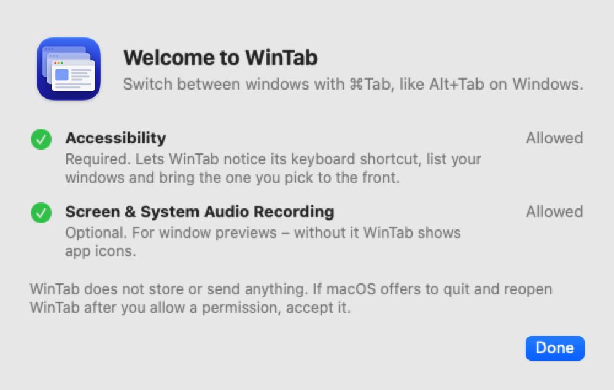

# WinTab



[](LICENSE)

A window switcher for macOS that works like **Alt+Tab on Windows**: it switches between *windows*, not apps.
Free, minimal, no upsells. Available in English and Slovak (follows the macOS language setting).

## Screenshots

Hold ⌘ and press Tab – window previews of all your desktops, most recently used first. The selected window has
a × to close it (with ⇧ held: force quit its app).



<p>
  
  
</p>

## Download

Get the latest **WinTab-x.y.z.zip** from [Releases](https://github.com/Furcenzo/wintab/releases/latest)
(universal app for Apple silicon and Intel, macOS 15 or later), unzip it and move **WinTab.app** to
/Applications.

The app is not notarized by Apple, so macOS blocks the first launch. Open
**System Settings → Privacy & Security** and click **Open Anyway** next to “WinTab”, or run:

```bash
xattr -dr com.apple.quarantine "/Applications/WinTab.app"
```

On the first start WinTab asks for its permissions (see below). Because the app is not signed with an Apple
Developer ID, macOS may forget the permissions after an update: remove WinTab from both lists in System
Settings and allow it again.

## Usage

- Hold **⌘ Command** and press **Tab** – the switcher shows previews of your windows on all desktops (Spaces)
  and fullscreen apps, most recently used first. Choosing a window on another desktop switches there.
- **Tab** / **→** / **↓** – next window, **⇧ Tab** / **←** / **↑** – previous window.
- Release **⌘** (or press **Return**) – switch to the selected window. A quick ⌘Tab flips to the previous window.
- **Esc** – close without switching. A mouse click on a window switches to it.
- Minimized windows are listed at the end and are restored when chosen; windows of hidden apps are shown too.

WinTab lives in the menu bar (no Dock icon). **Settings…** (⌘,) in its menu:

- **Shortcut** – ⌘Tab (replaces the system app switcher, the default) or ⌥Tab (keeps the system ⌘Tab),
- **Windows** – previews (or app icons), windows from all desktops or only the current one, minimized windows,
  windows of hidden apps, and on which screen the switcher appears,
- **Excluded apps** – apps whose windows never show up,
- **Open at login**, and the state of both permissions.

Quit WinTab from the same menu – the system ⌘Tab comes back as soon as WinTab quits, crashes or is
force-quit (a small watchdog process, also called WinTab, takes care of that). In password fields and with Terminal's Secure Keyboard Entry macOS hides key presses
from all apps, so ⌘Tab shows the system app switcher there.

## Permissions

On the first start a welcome window shows both permissions with **Allow…** buttons and their live state.

- **Accessibility** (required) – to notice the shortcut, read the list of windows and bring the chosen one to
  the front: **System Settings → Privacy & Security → Accessibility**.
- **Screen & System Audio Recording** (optional) – for window previews. macOS asks once; turn WinTab on in
  **System Settings → Privacy & Security → Screen & System Audio Recording** and let macOS quit and reopen it.
  Without it WinTab shows app icons. macOS may ask from time to time to confirm this permission again.

WinTab only uses this to draw small window images in the switcher; it does not store or send anything.

## Requirements

- macOS 15 or later
- Swift 6 toolchain (Xcode 16 or later) to build from source

## Building

```bash
swift build
swift test
```

Build the app into `build/WinTab.app` (and restart it):

```bash
./scripts/run.sh
```

### Stable code signature for development

macOS remembers the Accessibility permission per code signature. An ad-hoc signed build gets a new
signature every time, so macOS would ask for the permission after every build. Create a local
self-signed certificate once (it asks for your login password):

```bash
./scripts/setup-dev-signing.sh
```

From then on `scripts/build-app.sh` signs every build with **"WinTab Local Dev"** and the permission
survives rebuilds. The certificate only works on your Mac; remove it any time in Keychain Access.

## Debugging

The binary inside the bundle accepts environment variables (output on stdout):

- `WINTAB_LIST=1` – print the windows the switcher would offer and quit,
- `WINTAB_SNAPSHOT=/path.png` – save an image of the switcher overlay and quit (no screen recording needed;
  with `WINTAB_VIEW=settings` or `permissions` an image of that window),
- `WINTAB_SWITCH=<n>` – switch to the n-th window of the list and print which window is in front afterwards,
- `WINTAB_CYCLE=<n>` – open, move and close the switcher overlay n times (smoke test) and quit,
- `WINTAB_SPACES=1` – print the desktops (Spaces), the windows on them and what the private APIs find,
- `WINTAB_ONLY_APPS=com.apple.Safari,…` – list only these apps (for screenshots with demo windows; the README
  screenshots show Safari, Preview, Calculator and Font Book).

The running app logs focus changes and window lists:

```bash
log stream --level debug --predicate 'subsystem == "io.github.furcenzo.wintab"'
```

```bash
WINTAB_LIST=1 build/WinTab.app/Contents/MacOS/WinTab
```

## Translations

Texts in the code are English; translations live in `Sources/WinTab/Resources/<language>.lproj/Localizable.strings`
(the key is the English text). After changing any user-facing text, run:

```bash
./scripts/check-localization.sh
```

To run it automatically before every commit, enable the bundled git hook once per clone:

```bash
git config core.hooksPath .githooks
```

See [CLAUDE.md](CLAUDE.md) for the detailed rules.

## Project structure

- `Sources/WinTabCore` – window list ordering, selection and hotkey logic (no UI, tested).
- `Sources/CPrivate` – private macOS APIs (Spaces, window focus, window capture), looked up at run time.
- `Sources/WinTab` – the app: keyboard event tap, ⌘Tab takeover, focus tracking, window list via
  Accessibility, overlay panel, menu bar.
- `Tests/WinTabCoreTests` – tests for the core logic.
- `Assets/` – the app icon (`AppIcon.icns`, `AppIcon.png`), drawn by `swift scripts/make-icon.swift`, and the
  README screenshots (`screenshots/`).
- `scripts/` – app bundle build, dev signing setup, icon, release, translation check and the Claude Code hook.

## Acknowledgments

[AltTab](https://github.com/lwouis/alt-tab-macos) by Louis Pontoise and contributors (GPL-3.0) – the local
code signing setup is based on its `scripts/codesign`, and WinTab's use of private macOS APIs follows its
research: turning off the system ⌘Tab (`CGSSetSymbolicHotKeyEnabled`), listing windows of all Spaces,
finding their accessibility elements through remote tokens, capturing windows on other Spaces and focusing
one exact window (`_SLPSSetFrontProcessWithOptions` + the key-window event record). AltTab in turn credits
[yabai](https://github.com/koekeishiya/yabai) and [Hammerspoon](https://github.com/Hammerspoon/hammerspoon).

WinTab uses these private APIs only where macOS has no public way; they are looked up at run time, so if a
macOS update removes them, WinTab keeps working with the current desktop only.

## License

Copyright (C) 2026 Furcenzo

This program is free software: you can redistribute it and/or modify it under the terms of the
[GNU General Public License](LICENSE) as published by the Free Software Foundation, either version 3
of the License, or (at your option) any later version (`GPL-3.0-or-later`).
This program is distributed in the hope that it will be useful, but WITHOUT ANY WARRANTY.
See the [LICENSE](LICENSE) file for the full text.
